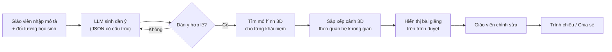

# Xây dựng công cụ soạn bài giảng trực quan có minh hoạ 3D cho học sinh tiểu học học tiếng Anh

Sinh viên: Đinh Đức Mạnh – MSSV: 20235774

Giảng viên hướng dẫn: Nguyễn Duy Hiệp

## 1. Bối cảnh và lý do chọn đề tài

### 1.1 Bối cảnh

Với học sinh tiểu học, **hình ảnh trực quan** là cách hiệu quả nhất để học từ vựng và các khái niệm mới trong tiếng Anh. Tuy nhiên, có một nhóm kiến thức mà hình ảnh 2D thông thường thể hiện chưa tốt: **quan hệ không gian**, tiêu biểu là các **giới từ chỉ vị trí** (*in, on, under, behind, in front of, next to, between…*). Một bức ảnh chụp thẳng khó phân biệt "con mèo ở **sau** cái hộp" với "con mèo ở **cạnh** cái hộp", trong khi một cảnh **3D xoay được** cho học sinh nhìn từ nhiều góc và thấy rõ vị trí của vật.

Hiện nay giáo viên thường soạn bài theo các cách:

- **PowerPoint / Google Slides với ảnh tìm trên mạng:** mất thời gian tìm ảnh phù hợp, ảnh không đồng bộ về phong cách, khó tìm đúng ảnh thể hiện quan hệ vị trí mong muốn.
- **Công cụ tạo slide bằng AI:** sinh nhanh dàn ý và nội dung, nhưng minh hoạ chủ yếu là ảnh 2D; ảnh do AI vẽ có thể sai chi tiết (ví dụ vẽ con mèo nằm *trên* bàn khi đề bài là *dưới* bàn) và khó chỉnh sửa.
- **Công cụ dựng cảnh 3D (Blender, Unity, các nền tảng 3D cho giáo dục):** tạo được cảnh 3D đẹp nhưng đòi hỏi kỹ năng dựng hình, mất nhiều thời gian, gần như không phù hợp với giáo viên tiểu học.

### 1.2 Vấn đề đặt ra

Giáo viên cần một công cụ mà chỉ cần **mô tả bằng lời** nội dung bài học và đối tượng học sinh, hệ thống sẽ:

1. **Hiểu yêu cầu** và **sinh dàn ý** bài giảng phù hợp với trình độ học sinh;
2. **Chọn đúng các mô hình 3D** có sẵn trong thư viện để minh hoạ;
3. **Sắp xếp các mô hình thành cảnh 3D đúng ý nghĩa** (ví dụ đặt con mèo đúng *dưới* cái bàn);
4. Cho phép giáo viên **chỉnh sửa** và **trình chiếu** trực tiếp trên trình duyệt.

### 1.3 Điểm khác biệt của đề tài

- **Minh hoạ 3D tương tác** thay cho ảnh 2D tĩnh: học sinh xoay, phóng to cảnh để quan sát vị trí của vật.
- **Ghép từ thư viện mô hình có sẵn** thay vì để AI tự vẽ ảnh: hình minh hoạ luôn rõ ràng, đồng bộ phong cách, **đặt vị trí theo quy tắc** nên đúng nghĩa của giới từ và giáo viên chỉnh sửa được.
- **Tự động hoá từ mô tả bằng lời đến cảnh 3D**, giáo viên không cần kỹ năng dựng hình.
- **Miễn phí và chạy được trên máy cá nhân:** sử dụng mô hình ngôn ngữ mã nguồn mở chạy cục bộ, không phụ thuộc dịch vụ trả phí.

### 1.4 Lý do cá nhân

- Đề tài kết hợp nhiều lĩnh vực: xử lý ngôn ngữ tự nhiên bằng mô hình ngôn ngữ lớn (LLM), tìm kiếm ngữ nghĩa, đồ hoạ 3D trên web và phát triển ứng dụng web.
- Có các bài toán cần nghiên cứu và đánh giá được bằng thực nghiệm, không chỉ dừng ở việc xây dựng ứng dụng.
- Sản phẩm có ý nghĩa thực tế cho việc dạy tiếng Anh ở bậc tiểu học.

## 2. Mục tiêu và phạm vi

### 2.1 Mục tiêu

**Mục tiêu tổng quát:** Xây dựng công cụ web giúp giáo viên tiếng Anh tiểu học soạn bài giảng có minh hoạ 3D chỉ bằng cách mô tả nội dung bằng lời, trong đó hệ thống tự sinh dàn ý, chọn mô hình 3D từ thư viện và sắp xếp thành cảnh 3D đúng ý nghĩa; đồng thời đánh giá bằng thực nghiệm độ chính xác của từng bước.

**Mục tiêu cụ thể:**

1. **Sinh dàn ý có cấu trúc:** dùng LLM mã nguồn mở chạy cục bộ để chuyển mô tả của giáo viên thành dàn ý bài giảng dạng dữ liệu có cấu trúc (JSON), gồm các slide, từ vựng, câu mẫu và mô tả cảnh cần minh hoạ.
2. **Tìm mô hình 3D phù hợp:** xây dựng thư viện khoảng 100 mô hình 3D miễn phí bản quyền, có tên và thẻ mô tả; tìm mô hình phù hợp với từng khái niệm bằng kết hợp tìm theo từ khoá và tìm theo ngữ nghĩa (embedding).
3. **Sắp xếp cảnh 3D theo quan hệ không gian:** đặt các mô hình đúng vị trí theo các giới từ được hỗ trợ, dựa trên kích thước thực của từng mô hình.
4. **Soạn và trình chiếu:** giao diện web cho phép giáo viên xem, chỉnh sửa dàn ý và cảnh 3D, trình chiếu và chia sẻ bài giảng cho học sinh qua đường liên kết.
5. **Đánh giá bằng thực nghiệm:** đo độ chính xác chọn mô hình, độ chính xác đặt vị trí, chất lượng dàn ý và mức độ dễ sử dụng của công cụ (mục 8).

### 2.2 Trong phạm vi (sẽ làm)

- **Đối tượng học:** học sinh tiểu học, trình độ tiếng Anh sơ cấp.
- **Nội dung:** gồm **hai nhóm** kiến thức, có thể dạy riêng hoặc kết hợp trong cùng một bài:
  - **Từ vựng theo 5 chủ đề:** lớp học, ngôi nhà, con vật, đồ ăn, đồ chơi. Ví dụ bài "Animals" minh hoạ từng con vật bằng mô hình 3D.
  - **Giới từ chỉ vị trí:** *in, on, under, behind, in front of, next to, between*. Ví dụ bài "Where is the cat?" dùng các vật thuộc 5 chủ đề trên để minh hoạ vị trí.
- **Ngôn ngữ đầu vào:** giáo viên mô tả bằng tiếng Việt hoặc tiếng Anh; nội dung bài giảng bằng tiếng Anh, có kèm nghĩa tiếng Việt.
- **Thư viện 3D:** khoảng 100 mô hình định dạng `.glb`, lấy từ các kho có giấy phép CC0; mỗi mô hình có tên, thẻ mô tả, chủ đề, kích thước chuẩn hoá.
- **Sinh bài giảng:** từ mô tả của giáo viên sinh dàn ý, chọn mô hình và dựng cảnh 3D cho từng slide.
- **Chỉnh sửa:** sửa nội dung chữ của slide; đổi mô hình; kéo, xoay, phóng to mô hình trong cảnh; thêm, xoá, sắp xếp slide.
- **Trình chiếu và chia sẻ:** trình chiếu toàn màn hình trên trình duyệt; tạo đường liên kết chỉ xem cho học sinh.
- **Tương tác với cảnh 3D khi trình chiếu** (giáo viên và học sinh xem qua đường liên kết đều dùng được):
  1. Xoay, phóng to, thu nhỏ cảnh để nhìn vật từ nhiều góc;
  2. Bấm vào vật để hiện từ tiếng Anh, nghĩa tiếng Việt và nghe phát âm;
  3. Đổi giới từ ngay trên slide: vật di chuyển tới vị trí mới, câu mẫu và nghĩa đổi theo;
  4. Đố vui: hệ thống đặt vật ở một vị trí ngẫu nhiên, người xem chọn câu mô tả đúng và được báo đúng hay sai.
  - Kéo thả vật vào đúng vị trí theo yêu cầu (ví dụ "Put the cat under the table") chỉ làm **nếu còn thời gian**.
- **Tài khoản:** giáo viên đăng ký, đăng nhập, quản lý danh sách bài giảng của mình.
- **Quản trị thư viện:** quản trị viên thêm, sửa thông tin, ẩn mô hình trong thư viện.

### 2.3 Ngoài phạm vi (KHÔNG làm trong thời gian thực hiện)

- **Sinh mô hình 3D mới bằng AI** (text-to-3D): hệ thống chỉ chọn và ghép mô hình có sẵn trong thư viện.
- **Môn học khác và cấp học khác** ngoài tiếng Anh tiểu học.
- **Hoạt hình phức tạp** (nhân vật chuyển động, diễn hoạt theo kịch bản).
- **Thực tế ảo / thực tế tăng cường** (kính VR, AR trên điện thoại).
- **Xuất file** PowerPoint, PDF, video.
- **Tài khoản học sinh, giao bài tập, chấm điểm, theo dõi kết quả học tập.** Đố vui trong lúc trình chiếu chỉ báo đúng hay sai ngay tại chỗ, không lưu kết quả.
- **Giáo viên tự tải mô hình 3D lên thư viện.**
- **Soạn bài nhiều người cùng lúc** (cộng tác thời gian thực).

## 3. Đối tượng sử dụng (Actor / Vai trò)

| Vai trò | Mô tả | Ví dụ thực tế |
| --- | --- | --- |
| **Khách** (chưa đăng nhập) | Chỉ truy cập được trang giới thiệu, trang `Đăng nhập`, `Đăng ký`, và các bài giảng được chia sẻ qua đường liên kết (chế độ chỉ xem). | Học sinh mở đường liên kết bài giảng giáo viên gửi qua Zalo. |
| **Giáo viên** (đã đăng nhập) | Tạo bài giảng bằng mô tả, chỉnh sửa, trình chiếu, chia sẻ bài giảng của **chính mình**. Không xem hay sửa được bài giảng chưa chia sẻ của giáo viên khác. | Cô giáo tiếng Anh lớp 3 soạn bài "Prepositions of place". |
| **Quản trị viên hệ thống** | Quản lý thư viện mô hình 3D (thêm, sửa thông tin, ẩn mô hình) và quản lý tài khoản giáo viên (khoá, mở khoá). Tài khoản được tạo sẵn, không đăng ký được qua giao diện. | Sinh viên thực hiện đề tài, người xây dựng và vận hành thư viện. |

## 4. Phân quyền (Ma trận quyền)

Ký hiệu: 
- ✅ được phép
- ❌ không được phép
- 🔸 được phép có điều kiện 
- `—` không áp dụng

| Chức năng | Khách | Giáo viên | Quản trị viên |
| --- | :-: | :-: | :-: |
| Đăng ký tài khoản giáo viên | ✅ | ❌ | ❌ |
| Đăng nhập (sau khi đăng nhập trở thành Giáo viên hoặc Quản trị viên) | ✅ | — | — |
| Đăng xuất, đổi mật khẩu | ❌ | ✅ | ✅ |
| Xem bài giảng qua đường liên kết chia sẻ | ✅ | ✅ | ✅ |
| Tạo bài giảng mới từ mô tả | ❌ | ✅ | ❌ |
| Xem, sửa, xoá, trình chiếu bài giảng | ❌ | 🔸 (*) | ❌ |
| Bật / tắt chia sẻ bài giảng | ❌ | 🔸 (*) | ❌ |
| Duyệt thư viện mô hình 3D | ❌ | ✅ | ✅ |
| Thêm, sửa thông tin, ẩn mô hình trong thư viện | ❌ | ❌ | ✅ |
| Xem danh sách, khoá, mở khoá tài khoản giáo viên | ❌ | ❌ | ✅ |

**Ghi chú:** (*) chỉ với bài giảng do chính mình tạo.


## 5. Kiến trúc và luồng xử lý chính

### 5.1 Luồng sinh bài giảng



**Bước 1 – Nhập yêu cầu.** Giáo viên nhập mô tả, ví dụ: *"Bài học về giới từ chỉ vị trí in, on, under cho học sinh lớp 3, dùng đồ vật trong lớp học, khoảng 5 slide"*.

**Bước 2 – Sinh dàn ý.** LLM chạy cục bộ sinh dàn ý theo **định dạng JSON cố định**. Mỗi slide gồm: tiêu đề, từ vựng (tiếng Anh, nghĩa tiếng Việt), câu mẫu, và **mô tả cảnh** dưới dạng danh sách vật thể và quan hệ không gian, ví dụ:

```json
{
  "title": "Under",
  "sentence": "The cat is under the table.",
  "scene": {
    "objects": ["cat", "table"],
    "relations": [{ "subject": "cat", "relation": "under", "object": "table" }]
  }
}
```

Hệ thống kiểm tra dàn ý đúng định dạng và chỉ dùng các giới từ được hỗ trợ; nếu sai thì yêu cầu LLM sinh lại.

**Bước 3 – Tìm mô hình 3D.** Với mỗi vật thể (ví dụ `cat`), hệ thống tìm mô hình phù hợp nhất trong thư viện bằng cách kết hợp:

- **Tìm theo từ khoá:** so khớp với tên và thẻ của mô hình;
- **Tìm theo ngữ nghĩa:** so sánh vector ngữ nghĩa (embedding) của khái niệm với vector của mô hình, để tìm được cả khi khác từ (ví dụ `kitten` → mô hình `cat`, `desk` → mô hình `table`).

Nếu không có mô hình nào đủ phù hợp, slide hiển thị **thẻ chữ thay thế** và gợi ý cho giáo viên chọn mô hình thủ công.

**Bước 4 – Sắp xếp cảnh 3D.** Mỗi giới từ có một **quy tắc đặt vị trí** dựa trên hộp bao (bounding box) của mô hình. Ví dụ với *under*: đặt vật A nằm trong khoảng trống phía dưới mặt của vật B và không chạm xuyên qua B. Hệ thống tự chọn góc camera để thấy rõ quan hệ.

**Bước 5 – Hiển thị, chỉnh sửa, trình chiếu.** Cảnh 3D hiển thị bằng WebGL trên trình duyệt; giáo viên có thể sửa nội dung, đổi mô hình, kéo chỉnh vị trí, rồi trình chiếu hoặc chia sẻ.

### 5.2 Các thành phần hệ thống

| Thành phần | Nhiệm vụ |
| --- | --- |
| **Frontend (ReactJS + Three.js)** | Giao diện soạn bài, khung hiển thị 3D, chế độ trình chiếu |
| **Backend (Node.js + Express)** | API tài khoản, bài giảng, thư viện; điều phối luồng sinh bài giảng |
| **Dịch vụ LLM (Ollama, chạy cục bộ)** | Sinh dàn ý; tạo vector ngữ nghĩa cho khái niệm và mô hình |
| **Bộ tìm kiếm mô hình** | Kết hợp tìm theo từ khoá và theo ngữ nghĩa, trả về mô hình phù hợp nhất kèm điểm tương đồng |
| **Bộ sắp xếp cảnh** | Áp dụng quy tắc đặt vị trí theo giới từ, chọn góc camera |
| **CSDL (PostgreSQL)** | Lưu tài khoản, bài giảng, slide, thông tin thư viện mô hình và vector ngữ nghĩa |
| **Kho tệp mô hình 3D** | Lưu các tệp `.glb` và ảnh xem trước |

## 6. Chức năng chi tiết

Mức ưu tiên: **Must** (bắt buộc) / **Should** (nên có) / **Could** (làm nếu còn thời gian)

### 6.1 Tài khoản

| Mã | Tên chức năng | Vai trò | Mô tả ngắn | Ưu tiên |
| --- | --- | --- | --- | --- |
| F01 | Đăng ký | Khách | Tạo tài khoản giáo viên bằng email, tên hiển thị, mật khẩu. | Must |
| F02 | Đăng nhập, đăng xuất | Giáo viên, Quản trị viên | Tài khoản bị khoá không đăng nhập được. | Must |
| F03 | Đổi mật khẩu | Giáo viên, Quản trị viên | Nhập mật khẩu cũ và mật khẩu mới. | Could |

### 6.2 Sinh bài giảng

| Mã | Tên chức năng | Vai trò | Mô tả ngắn | Ưu tiên |
| --- | --- | --- | --- | --- |
| F10 | Nhập yêu cầu bài giảng | Giáo viên | Nhập mô tả nội dung, chọn khối lớp, số slide mong muốn. | Must |
| F11 | Sinh dàn ý | Hệ thống | LLM sinh dàn ý JSON; kiểm tra định dạng, sinh lại nếu sai. | Must |
| F12 | Tìm mô hình 3D | Hệ thống | Chọn mô hình phù hợp nhất cho từng vật thể; dùng thẻ chữ thay thế nếu không tìm được. | Must |
| F13 | Dựng cảnh 3D | Hệ thống | Sắp xếp mô hình theo quan hệ không gian, chọn góc camera. | Must |
| F14 | Xem tiến trình sinh | Giáo viên | Hiển thị đang ở bước nào (sinh dàn ý, tìm mô hình, dựng cảnh). | Should |

### 6.3 Soạn và chỉnh sửa bài giảng

| Mã | Tên chức năng | Vai trò | Mô tả ngắn | Ưu tiên |
| --- | --- | --- | --- | --- |
| F20 | Danh sách bài giảng | Giáo viên | Xem, tìm kiếm, mở, xoá bài giảng của mình. | Must |
| F21 | Sửa nội dung slide | Giáo viên | Sửa tiêu đề, từ vựng, nghĩa, câu mẫu. | Must |
| F22 | Xem cảnh 3D | Giáo viên | Xoay, phóng to, thu nhỏ cảnh bằng chuột hoặc cảm ứng. | Must |
| F23 | Đổi mô hình | Giáo viên | Chọn mô hình khác từ danh sách gợi ý hoặc từ thư viện. | Must |
| F24 | Chỉnh vị trí mô hình | Giáo viên | Kéo, xoay, đổi kích thước mô hình trong cảnh. | Should |
| F25 | Thêm, xoá, sắp xếp slide | Giáo viên | Thêm slide trống, xoá slide, kéo thả đổi thứ tự. | Should |
| F26 | Sinh lại một slide | Giáo viên | Yêu cầu hệ thống sinh lại nội dung và cảnh của một slide. | Could |
| F27 | Phát âm từ vựng | Giáo viên, Khách | Đọc từ và câu mẫu bằng giọng đọc có sẵn của trình duyệt. | Should |

### 6.4 Trình chiếu và chia sẻ

| Mã | Tên chức năng | Vai trò | Mô tả ngắn | Ưu tiên |
| --- | --- | --- | --- | --- |
| F30 | Trình chiếu | Giáo viên | Chế độ toàn màn hình, chuyển slide bằng bàn phím; cảnh 3D vẫn xoay được. | Must |
| F31 | Chia sẻ bằng đường liên kết | Giáo viên | Bật chia sẻ để tạo đường liên kết chỉ xem; tắt chia sẻ thì đường liên kết hết hiệu lực. | Should |
| F32 | Xem bài giảng được chia sẻ | Khách | Xem bài giảng và dùng được các tương tác ở mục 6.5, không chỉnh sửa được. | Should |

### 6.5 Tương tác với cảnh 3D khi trình chiếu

Dùng được cả khi giáo viên trình chiếu (F30) và khi học sinh xem qua đường liên kết (F32).

| Mã | Tên chức năng | Mức | Mô tả ngắn | Ưu tiên |
| --- | --- | :-: | --- | --- |
| F33 | Xoay, phóng to cảnh | 1 | Kéo chuột hoặc vuốt để xoay, cuộn chuột hoặc chụm ngón tay để phóng to, thu nhỏ. | Must |
| F34 | Bấm vào vật | 2 | Hiện từ tiếng Anh và nghĩa tiếng Việt của vật được bấm, kèm phát âm (F27). | Should |
| F35 | Đổi giới từ trên slide | 3 | Với slide về giới từ: chọn một giới từ khác, vật di chuyển mượt tới vị trí mới theo bộ sắp xếp cảnh; câu mẫu và nghĩa đổi theo. | Should |
| F36 | Đố vui vị trí | 4 | Hệ thống đặt vật ở vị trí ngẫu nhiên trong các giới từ được hỗ trợ và đưa ra 4 câu để chọn; báo đúng hay sai ngay, không lưu kết quả. | Should |
| F37 | Kéo thả vật vào đúng vị trí | 5 | Hệ thống yêu cầu đặt vật theo một câu (ví dụ "Put the cat under the table"); người xem kéo thả vật, hệ thống kiểm tra quan hệ không gian và báo đúng hay sai. | Could |

### 6.6 Quản trị thư viện mô hình 3D

| Mã | Tên chức năng | Vai trò | Mô tả ngắn | Ưu tiên |
| --- | --- | --- | --- | --- |
| F40 | Nhập mô hình vào thư viện | Quản trị viên | Tải tệp `.glb`, nhập tên, thẻ mô tả, chủ đề, nguồn và giấy phép; hệ thống tự đo kích thước, tạo ảnh xem trước và vector ngữ nghĩa. | Must |
| F41 | Duyệt thư viện | Giáo viên, Quản trị viên | Xem danh sách mô hình theo chủ đề, tìm theo tên. | Must |
| F42 | Sửa thông tin, ẩn mô hình | Quản trị viên | Mô hình bị ẩn không được dùng cho bài giảng mới; bài giảng cũ vẫn hiển thị bình thường. | Should |
| F43 | Quản lý tài khoản giáo viên | Quản trị viên | Xem danh sách, khoá và mở khoá tài khoản. | Could |

## 7. Quy tắc nghiệp vụ

**Bài giảng**

- **BR01:** Mỗi bài giảng có từ 1 đến 10 slide; mỗi slide minh hoạ tối đa 4 vật thể.
- **BR02:** Chỉ hỗ trợ 7 giới từ: *in, on, under, behind, in front of, next to, between*. Dàn ý chứa giới từ khác bị coi là không hợp lệ và được sinh lại.
- **BR03:** Mỗi lần sinh dàn ý được thử lại tối đa 3 lần nếu không đúng định dạng; quá 3 lần thì báo lỗi để giáo viên sửa lại mô tả.
- **BR04:** Giáo viên chỉ xem, sửa, xoá, chia sẻ được bài giảng do chính mình tạo.
- **BR05:** Bài giảng chỉ xem được qua đường liên kết khi đang bật chia sẻ; tắt chia sẻ thì đường liên kết cũ không còn truy cập được.

**Thư viện mô hình**

- **BR06:** Mỗi mô hình phải có: tên tiếng Anh, ít nhất 1 thẻ mô tả, chủ đề, nguồn tải, giấy phép. Chỉ nhận mô hình có giấy phép cho phép sử dụng lại (ưu tiên CC0).
- **BR07:** Kích thước mô hình được chuẩn hoá theo tỉ lệ thực tế tương đối (ví dụ con mèo nhỏ hơn cái bàn) để cảnh 3D hợp lý.
- **BR08:** Mô hình bị ẩn không xuất hiện trong kết quả tìm kiếm, nhưng các bài giảng đã dùng mô hình đó vẫn hiển thị bình thường.

**Tìm mô hình và dựng cảnh**

- **BR09:** Một mô hình chỉ được chọn tự động khi điểm tương đồng vượt **ngưỡng** xác định qua thực nghiệm; dưới ngưỡng thì hiển thị thẻ chữ thay thế.
- **BR10:** Các mô hình trong cảnh không được chồng lấn xuyên qua nhau (kiểm tra bằng hộp bao).
- **BR11:** Góc camera mặc định phải thấy được toàn bộ các vật thể trong cảnh.

## 8. Câu hỏi nghiên cứu và phương pháp đánh giá

### 8.1 Câu hỏi nghiên cứu

| Mã | Câu hỏi |
| --- | --- |
| **RQ1** | Kết hợp tìm theo từ khoá và tìm theo ngữ nghĩa có chọn **đúng mô hình 3D** tốt hơn từng cách riêng lẻ không? |
| **RQ2** | Bộ sắp xếp cảnh dựa trên quy tắc có đặt các vật thể **đúng quan hệ không gian** của giới từ không? |
| **RQ3** | LLM mã nguồn mở chạy cục bộ có sinh được **dàn ý đúng định dạng và phù hợp trình độ** học sinh tiểu học không? |
| **RQ4** | Công cụ có giúp giáo viên **soạn bài nhanh hơn** và có **dễ sử dụng** không? |

### 8.2 Phương pháp đánh giá

| Câu hỏi | Dữ liệu thử nghiệm | Chỉ số đánh giá | So sánh |
| --- | --- | --- | --- |
| **RQ1** | Bộ khoảng 150 khái niệm có gán nhãn mô hình đúng, gồm từ trùng tên, từ đồng nghĩa, từ tiếng Việt và khái niệm không có trong thư viện | Độ chính xác top-1, top-3; tỉ lệ nhận biết đúng khái niệm không có trong thư viện | Chỉ từ khoá / chỉ ngữ nghĩa / kết hợp |
| **RQ2** | Bộ khoảng 70 câu mô tả cảnh (7 giới từ × khoảng 10 cặp vật thể) | Tỉ lệ cảnh đặt đúng quan hệ (kiểm tra tự động bằng hộp bao và người đánh giá); tỉ lệ cảnh có vật chồng lấn | Giữa các giới từ |
| **RQ3** | Khoảng 20 mô tả bài giảng mẫu | Tỉ lệ dàn ý đúng định dạng ngay lần đầu; điểm phù hợp trình độ theo thang chấm (độ dài câu, từ vựng cơ bản) | Giữa 2 mô hình mã nguồn mở; nếu kịp, so sánh thêm với mô hình trên mạng (gói miễn phí) |
| **RQ4** | Thử nghiệm với 3–5 người (giáo viên hoặc sinh viên sư phạm) | Thời gian soạn một bài; điểm khảo sát mức độ dễ sử dụng (thang SUS) | So với soạn bằng PowerPoint |

## 9. Dữ liệu chính (các thực thể)

| Thực thể | Thuộc tính chính |
| --- | --- |
| **Người dùng** | id, email, tên hiển thị, mật khẩu (đã mã hoá), vai trò (`TEACHER` / `SYSTEM_ADMIN`), bị khoá, ngày tạo |
| **Bài giảng** | id, giáo viên tạo, tiêu đề, mô tả yêu cầu ban đầu, khối lớp, trạng thái chia sẻ, mã chia sẻ, ngày tạo, ngày sửa |
| **Slide** | id, bài giảng, thứ tự, tiêu đề, từ vựng (tiếng Anh, nghĩa tiếng Việt), câu mẫu, dữ liệu cảnh 3D (danh sách mô hình, vị trí, góc xoay, tỉ lệ, góc camera) |
| **Mô hình 3D** | id, tên, thẻ mô tả, chủ đề, đường dẫn tệp `.glb`, ảnh xem trước, kích thước hộp bao, tỉ lệ chuẩn, nguồn, giấy phép, vector ngữ nghĩa, bị ẩn |
| **Lần sinh bài giảng** | id, bài giảng, mô hình LLM đã dùng, dàn ý trả về, số lần thử lại, thời gian xử lý, lỗi (nếu có). Dùng cho đánh giá ở mục 8 |

## 10. Yêu cầu phi chức năng

- **NFR01 – Hiệu năng sinh bài giảng:** sinh một bài giảng 5 slide trong khoảng **60 giây** trên máy cá nhân (GPU 6 GB).
- **NFR02 – Hiệu năng hiển thị 3D:** cảnh 3D hiển thị mượt (khoảng 30 khung hình/giây trở lên) trên máy tính xách tay phổ thông; mỗi tệp mô hình dưới 2 MB.
- **NFR03 – Bảo mật:** mật khẩu mã hoá bằng bcrypt; xác thực bằng JWT; mọi API kiểm tra quyền ở backend; truy vấn SQL có tham số.
- **NFR04 – Bản quyền:** mỗi mô hình 3D lưu rõ nguồn và giấy phép; trang thư viện hiển thị thông tin ghi công khi giấy phép yêu cầu.
- **NFR05 – Tương thích:** chạy trên các trình duyệt hỗ trợ WebGL 2 (Chrome, Edge, Firefox bản mới); giao diện bằng tiếng Việt.
- **NFR06 – Khả năng thay thế mô hình ngôn ngữ:** phần gọi LLM được tách riêng để đổi mô hình hoặc nhà cung cấp mà không sửa các phần khác (phục vụ so sánh ở RQ3).

## 11. Công nghệ dự kiến

| Thành phần | Công nghệ | Lý do chọn |
| --- | --- | --- |
| Frontend | ReactJS | Phổ biến, nhiều thư viện hỗ trợ |
| Hiển thị 3D | Three.js (qua React Three Fiber) | Thư viện đồ hoạ 3D trên web phổ biến nhất, đọc trực tiếp tệp `.glb`, tích hợp tốt với React |
| Backend | Node.js + Express | Dùng chung JavaScript với frontend, gọn nhẹ |
| CSDL | PostgreSQL | Đã cài đặt sẵn; lưu dữ liệu quan hệ và dữ liệu cảnh dạng `JSONB` |
| Mô hình ngôn ngữ | Mô hình mã nguồn mở cỡ 7–8 tỉ tham số, chạy bằng **Ollama** | Miễn phí, không giới hạn số lần gọi, chạy được trên GPU 6 GB |
| Vector ngữ nghĩa | Mô hình embedding đa ngôn ngữ chạy bằng Ollama | Miễn phí, hỗ trợ cả tiếng Việt và tiếng Anh |
| Tìm kiếm vector | Tính độ tương đồng cosin trực tiếp trong Node.js | Thư viện chỉ khoảng 100 mô hình nên không cần cơ sở dữ liệu vector riêng |
| Mô hình 3D | Tệp `.glb` từ các kho có giấy phép CC0 (phong cách low-poly) | Miễn phí, phong cách đồng bộ, dung lượng nhỏ |

## 12. Kế hoạch

### 12.1 Nguyên tắc lập kế hoạch

- **Làm phần lõi kỹ thuật trước, giao diện sau.** Luồng *mô tả → dàn ý → mô hình → cảnh 3D* là phần nghiên cứu chính nên làm xong trước (mốc M4); giao diện web làm sau.
- **Chuẩn bị dữ liệu thực nghiệm sớm.** Bộ dữ liệu cho RQ1, RQ2, RQ3 được gán nhãn ngay khi xây thư viện và làm từng bộ phận, không dồn đến cuối.
- **Không cắt phần thực nghiệm.** Nếu trễ, cắt bớt chức năng theo thứ tự ở mục 12.6, giữ nguyên giai đoạn 8.
- **Báo cáo viết dần theo từng giai đoạn** (mục 12.5), tuần cuối chỉ hoàn thiện.
- **Có thời gian dự phòng** khoảng 3 ngày ở cuối.
- Thời lượng tính theo **ngày làm việc**; một số công việc được làm song song nên tổng thời lượng các giai đoạn lớn hơn số ngày thực tế.

### 12.2 Tổng quan các giai đoạn

| Giai đoạn | Nội dung | Thời lượng | Tuần dự kiến | Kết thúc bằng mốc |
| --- | --- | --- | --- | --- |
| 0 | Chuẩn bị và khảo sát | 4 ngày | 1 | M1 |
| 1 | Xây thư viện mô hình 3D và dữ liệu gán nhãn | 6 ngày | 1–2 | M2 |
| 2 | Thiết kế hệ thống | 3 ngày | 2 | M2 |
| 3 | Sinh dàn ý bằng LLM | 4 ngày | 3 | M3 |
| 4 | Tìm mô hình 3D | 4 ngày | 3 | M3 |
| 5 | Bộ sắp xếp cảnh 3D | 6 ngày | 4 | M4 |
| 6 | Ứng dụng web | 9 ngày | 5–6 | M5 |
| 7 | Triển khai | 2 ngày | 6 | M5 |
| 8 | Thực nghiệm và đánh giá | 5 ngày | 6–7 | M6 |
| 9 | Hoàn thiện báo cáo, slide, demo | 3 ngày | 7 | M6 |
| — | Dự phòng | 3 ngày | 7 | |

### 12.3 Chi tiết từng giai đoạn

#### Giai đoạn 0 – Chuẩn bị và khảo sát (4 ngày)

| Mã | Công việc | Đầu ra |
| --- | --- | --- |
| CV0.1 | ✅Hoàn thiện tài liệu mô tả dự án | `docs/01-mo-ta-du-an.md` |
| CV0.2 | ✅Dựng bản thử nghiệm slide 3D bằng hình khối đơn giản | `prototype/slide-3d-demo.html` |
| CV0.3 | ✅Tạo kho mã nguồn Git, đưa lên GitHub; quy ước thư mục | Kho mã nguồn [20261-gr2-peekaboo](https://github.com/BabiBoo1011/20261-gr2-peekaboo.git) |
| CV0.4 | ✅Cài Ollama; tải và chạy thử 2 mô hình ngôn ngữ cỡ 7–8 tỉ tham số và 1 mô hình embedding đa ngôn ngữ | Ghi chú cài đặt |
| CV0.5 | ✅Thử sinh dàn ý JSON cho 3 mô tả mẫu; **đo thời gian** sinh và mức dùng bộ nhớ GPU | [Nhật ký tuần 1](nhat-ky/tuan-01.md) |
| CV0.6 | ✅Khảo sát các nguồn mô hình 3D có giấy phép CC0; thống kê số mô hình phù hợp với 5 chủ đề | Danh sách nguồn |
| CV0.7 | ✅Khảo sát nghiên cứu liên quan: các hệ thống sinh cảnh 3D từ văn bản (text-to-scene), dùng LLM sinh bố cục cảnh; công cụ soạn bài giảng có AI | Ghi chú tài liệu tham khảo (dùng cho chương tổng quan của báo cáo) |

✅**Mốc M1:** chạy được Ollama trên máy, sinh được 1 dàn ý JSON đúng định dạng; biết thời gian sinh thực tế; có danh sách nguồn mô hình 3D.

#### Giai đoạn 1 – Xây thư viện mô hình 3D và dữ liệu gán nhãn (6 ngày)

| Mã | Công việc | Phụ thuộc | Đầu ra |
| --- | --- | --- | --- |
| CV1.1 | Chốt danh sách khoảng 100 vật cần có theo 5 chủ đề, ưu tiên vật hay gặp trong sách giáo khoa tiếng Anh tiểu học | CV0.6 | Danh sách vật |
| CV1.2 | Tải mô hình `.glb`, ghi lại nguồn và giấy phép từng mô hình | CV1.1 | Thư mục mô hình gốc |
| CV1.3 | **Chuẩn hoá mô hình** bằng script: đưa gốc toạ độ về giữa đáy, quay đúng hướng (mặt trước nhìn trục +Z), đặt tỉ lệ theo kích thước thực tương đối, giảm dung lượng xuống dưới 2 MB | CV1.2 | Thư mục mô hình đã chuẩn hoá |
| CV1.4 | Đo **hộp bao** và ghi **thuộc tính phục vụ sắp xếp cảnh**: có mặt trên đặt đồ được không (bàn, giường), có chứa đồ được không (hộp, giỏ), độ cao khoảng trống phía dưới (gầm bàn, gầm ghế) | CV1.3 | Tệp thông tin mô hình (JSON) |
| CV1.5 | Viết tên, thẻ mô tả tiếng Anh và tiếng Việt, chủ đề cho từng mô hình | CV1.2 | Tệp thông tin mô hình |
| CV1.6 | Tạo ảnh xem trước cho từng mô hình | CV1.3 | Thư mục ảnh |
| CV1.7 | **Gán nhãn bộ dữ liệu RQ1:** khoảng 150 khái niệm kèm mô hình đúng, gồm trùng tên, đồng nghĩa, tiếng Việt, khái niệm không có trong thư viện; chia thành phần chỉnh tham số và phần đánh giá | CV1.5 | `data/rq1-concepts.json` |

**Đầu vào cho CV1.4:** chính các thuộc tính này giúp bộ sắp xếp cảnh biết đặt *on* lên mặt bàn, *in* vào trong hộp, *under* vào gầm bàn.

#### Giai đoạn 2 – Thiết kế hệ thống (3 ngày)

| Mã | Công việc | Đầu ra |
| --- | --- | --- |
| CV2.1 | Vẽ sơ đồ kiến trúc và luồng xử lý chi tiết | Sơ đồ kiến trúc |
| CV2.2 | Thiết kế **cấu trúc JSON** của dàn ý và của dữ liệu cảnh 3D; viết bộ kiểm tra định dạng (JSON Schema) | `docs/` + tệp schema |
| CV2.3 | Thiết kế CSDL (ERD, các bảng, ràng buộc); viết `schema.sql` | `docs/02-thiet-ke-csdl.md`, `database/schema.sql` |
| CV2.4 | Thiết kế danh sách API | `docs/03-thiet-ke-api.md` |
| CV2.5 | Phác thảo các màn hình chính: danh sách bài giảng, tạo bài giảng, soạn slide, trình chiếu, thư viện | Bản phác thảo giao diện |
| CV2.6 | Khởi tạo dự án ReactJS và Express; kết nối PostgreSQL và Ollama; hiển thị 1 mô hình `.glb` thật bằng React Three Fiber | Khung dự án chạy được |
| CV2.7 | **Chốt phương án triển khai** (xem giai đoạn 7) | Ghi chú quyết định |

**Mốc M2:** thư viện có ít nhất 80 mô hình đã chuẩn hoá, có đủ thông tin; bộ dữ liệu RQ1 đã gán nhãn; khung dự án chạy được, hiển thị được mô hình thật.

#### Giai đoạn 3 – Sinh dàn ý bằng LLM (4 ngày)

| Mã | Công việc | Đầu ra |
| --- | --- | --- |
| CV3.1 | Viết prompt hệ thống bằng tiếng Anh: vai trò, trình độ học sinh, danh sách giới từ hỗ trợ, **danh sách vật có trong thư viện**, ví dụ mẫu | Tệp prompt |
| CV3.2 | Gọi Ollama với JSON Schema (CV2.2) để ép cấu trúc đầu ra; kiểm tra lại định dạng; sinh lại tối đa 3 lần (BR03) | Mô-đun sinh dàn ý |
| CV3.2a | Ghép nghĩa tiếng Việt từ tên tiếng Việt của vật trong thư viện theo mẫu câu, không dùng bản dịch của LLM (thử nghiệm tuần 1: LLM dịch sai, ví dụ *ruler* thành "Kéo") | Hàm ghép nghĩa |
| CV3.3 | Kiểm tra nội dung: giới từ hợp lệ (BR02), số slide, số vật mỗi slide (BR01) | Bộ kiểm tra |
| CV3.4 | Ghi nhật ký mỗi lần sinh (mô hình, số lần thử, thời gian) để phục vụ RQ3 | Bảng lần sinh trong CSDL |
| CV3.5 | Soạn bộ dữ liệu RQ3: khoảng 20 mô tả bài giảng mẫu đa dạng (tiếng Việt, tiếng Anh, chủ đề, giới từ); soạn thang chấm mức độ phù hợp trình độ | `data/rq3-prompts.json`, thang chấm |
| CV3.6 | Tách phần gọi LLM thành lớp riêng để đổi mô hình dễ dàng (NFR06) | Mô-đun dùng chung |

#### Giai đoạn 4 – Tìm mô hình 3D (4 ngày)

| Mã | Công việc | Đầu ra |
| --- | --- | --- |
| CV4.1 | Tìm theo từ khoá: so khớp tên, thẻ (có xử lý số nhiều, viết hoa, tiếng Việt không dấu) | Hàm tìm theo từ khoá |
| CV4.2 | Tạo vector ngữ nghĩa cho toàn bộ thư viện từ **mô tả đầy đủ** (tên, thẻ tiếng Anh, thẻ tiếng Việt) và từ tên đơn lẻ (để so sánh ở RQ1); lưu vào CSDL | Vector của ~100 mô hình |
| CV4.3 | Tìm theo ngữ nghĩa bằng độ tương đồng cosin | Hàm tìm theo ngữ nghĩa |
| CV4.4 | Kết hợp hai cách (cộng điểm có trọng số) | Hàm tìm kết hợp |
| CV4.5 | **Chọn trọng số và ngưỡng** trên phần chỉnh tham số của bộ RQ1 (BR09) | Tham số đã chọn |
| CV4.6 | Viết script đánh giá RQ1 tự động (top-1, top-3, nhận biết khái niệm không có); chạy thử lần đầu | Kết quả RQ1 sơ bộ |

**Mốc M3:** chạy bằng dòng lệnh: nhập 1 mô tả → nhận dàn ý JSON hợp lệ → mỗi vật trong dàn ý được gắn với 1 mô hình trong thư viện (hoặc báo không tìm thấy); có kết quả RQ1 sơ bộ.

#### Giai đoạn 5 – Bộ sắp xếp cảnh 3D (6 ngày)

| Mã | Công việc | Đầu ra |
| --- | --- | --- |
| CV5.1 | Quy ước hệ toạ độ, đơn vị, hướng nhìn của cảnh | Ghi chú thiết kế |
| CV5.2 | Viết quy tắc đặt vị trí cho 6 giới từ hai vật: *in, on, under, behind, in front of, next to* (dùng hộp bao và thuộc tính ở CV1.4) | Mô-đun sắp xếp cảnh |
| CV5.3 | Viết quy tắc cho *between* (ba vật) | Mô-đun sắp xếp cảnh |
| CV5.4 | Xử lý trường hợp không đặt được (ví dụ vật to hơn gầm bàn, vật không chứa đồ được với *in*): thu nhỏ vật hoặc báo cảnh không hợp lệ | Quy tắc xử lý ngoại lệ |
| CV5.5 | Kiểm tra chồng lấn giữa các vật (BR10) | Hàm kiểm tra |
| CV5.6 | **Hàm kiểm tra quan hệ không gian**: cho vị trí hai vật, xác định có thoả giới từ không. Dùng cho RQ2 (chấm tự động) và cho F37 (kéo thả) | Hàm kiểm tra |
| CV5.7 | Tự chọn góc camera thấy rõ quan hệ và toàn bộ vật (BR11) | Mô-đun camera |
| CV5.8 | Soạn bộ dữ liệu RQ2: khoảng 70 câu mô tả cảnh (7 giới từ × khoảng 10 cặp vật) | `data/rq2-scenes.json` |
| CV5.9 | Viết kiểm thử tự động cho từng giới từ | Bộ kiểm thử |
| CV5.10 | Ghép nối toàn bộ luồng: mô tả → dàn ý → mô hình → cảnh 3D hiển thị trên trình duyệt | Luồng sinh hoàn chỉnh |

**Mốc M4 (mốc quan trọng nhất):** nhập *"Bài học về in, on, under cho lớp 3"* → trong khoảng 60 giây hiển thị được bài giảng nhiều slide có cảnh 3D đúng quan hệ không gian; đúng với ít nhất 6/7 giới từ. **Nên báo cáo thầy tại mốc này.**

#### Giai đoạn 6 – Ứng dụng web (9 ngày)

| Mã | Công việc | Chức năng | Ưu tiên |
| --- | --- | --- | --- |
| CV6.1 | Đăng ký, đăng nhập, đăng xuất; phân quyền ở backend; tài khoản quản trị tạo sẵn | F01, F02 | Must |
| CV6.2 | Danh sách bài giảng: xem, tìm, mở, xoá | F20 | Must |
| CV6.3 | Màn hình tạo bài giảng; hiển thị tiến trình sinh | F10, F14 | Must / Should |
| CV6.4 | Màn hình soạn slide: sửa nội dung chữ, đổi mô hình | F21, F22, F23 | Must |
| CV6.5 | Chỉnh vị trí mô hình bằng chuột; thêm, xoá, sắp xếp slide | F24, F25 | Should |
| CV6.6 | Chế độ trình chiếu toàn màn hình | F30 | Must |
| CV6.7 | Tương tác khi trình chiếu: xoay, bấm vật, phát âm, đổi giới từ, đố vui | F27, F33–F36 | Must / Should |
| CV6.8 | Chia sẻ bằng đường liên kết; trang xem cho khách | F31, F32 | Should |
| CV6.9 | Quản trị thư viện: nhập mô hình, sửa thông tin, ẩn mô hình | F40, F41, F42 | Must / Should |
| CV6.10 | Kiểm thử thủ công toàn bộ luồng theo vai trò; sửa lỗi | | Must |

#### Giai đoạn 7 – Triển khai (2 ngày)

Vì mô hình ngôn ngữ chạy trên máy cá nhân, phương án dự kiến là **chạy toàn bộ hệ thống trên máy cá nhân** và dùng một **dịch vụ đường hầm miễn phí** (ví dụ Cloudflare Tunnel) để có địa chỉ công khai khi demo và khi học sinh mở đường liên kết chia sẻ.

| Mã | Công việc | Đầu ra |
| --- | --- | --- |
| CV7.1 | Chuẩn bị cấu hình chạy cho bản demo (biến môi trường, dữ liệu mẫu, tài khoản mẫu) | Hướng dẫn chạy |
| CV7.2 | Cấu hình đường hầm, kiểm tra mở đường liên kết chia sẻ từ điện thoại và máy khác | Địa chỉ demo |
| CV7.3 | Chuẩn bị sẵn 3–5 bài giảng mẫu đã sinh để demo không phụ thuộc thời gian sinh | Bài giảng mẫu |

**Mốc M5:** ứng dụng web hoạt động đủ các chức năng Must và phần lớn Should; mở được bài giảng chia sẻ từ thiết bị khác.

#### Giai đoạn 8 – Thực nghiệm và đánh giá (5 ngày)

| Mã | Công việc | Đầu ra |
| --- | --- | --- |
| CV8.1 | Chạy RQ1 trên phần đánh giá: so sánh từ khoá / ngữ nghĩa / kết hợp | Bảng kết quả RQ1 |
| CV8.2 | Chạy RQ2: chấm tự động bằng CV5.6 và kiểm tra lại bằng mắt một phần; thống kê theo từng giới từ | Bảng kết quả RQ2 |
| CV8.3 | Chạy RQ3 với 2 mô hình mã nguồn mở: tỉ lệ đúng định dạng lần đầu, điểm phù hợp trình độ, thời gian sinh | Bảng kết quả RQ3 |
| CV8.4 | Thử nghiệm người dùng RQ4 với 3–5 người: soạn 1 bài bằng công cụ và bằng PowerPoint, đo thời gian, làm khảo sát SUS. **Liên hệ người tham gia từ tuần 5** | Kết quả RQ4 |
| CV8.5 | Phân tích kết quả, vẽ biểu đồ, rút ra nhận xét và hạn chế | Phần thực nghiệm của báo cáo |

#### Giai đoạn 9 – Hoàn thiện báo cáo, slide, demo (3 ngày)

| Mã | Công việc | Đầu ra |
| --- | --- | --- |
| CV9.1 | Hoàn thiện báo cáo: ghép các chương đã viết dần, viết kết luận và hướng phát triển | Báo cáo |
| CV9.2 | Làm slide bảo vệ | Slide |
| CV9.3 | Quay video demo dự phòng (phòng khi máy hoặc mạng gặp sự cố lúc bảo vệ) | Video demo |
| CV9.4 | Tập trình bày, chuẩn bị câu trả lời cho các câu hỏi thường gặp | |

### 12.4 Các mốc kiểm tra

| Mốc | Thời điểm | Điều kiện hoàn thành |
| --- | --- | --- |
| **M1** | Cuối tuần 1 | Ollama chạy được; sinh được dàn ý JSON đúng định dạng; biết thời gian sinh thực tế; có danh sách nguồn mô hình |
| **M2** | Cuối tuần 2 | Thư viện ≥ 80 mô hình chuẩn hoá có đủ thông tin; bộ dữ liệu RQ1 đã gán nhãn; khung dự án hiển thị được mô hình thật |
| **M3** | Cuối tuần 3 | Mô tả → dàn ý → mô hình chạy bằng dòng lệnh; có kết quả RQ1 sơ bộ |
| **M4** | Cuối tuần 4 | Mô tả → cảnh 3D hiển thị trên trình duyệt, đúng ≥ 6/7 giới từ, khoảng 60 giây |
| **M5** | Cuối tuần 6 | Ứng dụng web đủ chức năng Must; chia sẻ được qua đường liên kết |
| **M6** | Cuối tuần 7 | Có số liệu RQ1–RQ4; báo cáo, slide, video demo hoàn chỉnh |

### 12.5 Công việc thực hiện xuyên suốt

| Công việc | Tần suất |
| --- | --- |
| Gặp hoặc gửi báo cáo tiến độ cho giảng viên hướng dẫn: đã làm gì, kết quả mốc, khó khăn, việc tuần tới | Mỗi tuần |
| Đưa mã nguồn lên GitHub | Hằng ngày |
| Ghi nhật ký kỹ thuật: quyết định thiết kế, lỗi gặp phải và cách xử lý (làm tư liệu viết báo cáo) | Hằng ngày |
| **Viết báo cáo theo từng chương:** tổng quan và cơ sở lý thuyết (sau giai đoạn 0–1); phân tích thiết kế (sau giai đoạn 2); phương pháp sinh dàn ý, tìm mô hình, sắp xếp cảnh (sau giai đoạn 3–5); cài đặt (sau giai đoạn 6); thực nghiệm (giai đoạn 8) | Cuối mỗi giai đoạn |

### 12.6 Thứ tự cắt giảm khi bị trễ tiến độ

Nếu trễ so với mốc, cắt bớt chức năng theo thứ tự dưới đây (cắt từ trên xuống); **không cắt giai đoạn 8**:

1. F37 – Kéo thả vật vào đúng vị trí
2. F43 – Quản lý tài khoản giáo viên; F03 – Đổi mật khẩu
3. F26 – Sinh lại một slide
4. F24, F25 – Chỉnh vị trí mô hình bằng chuột; thêm, xoá, sắp xếp slide
5. F14 – Hiển thị tiến trình sinh
6. F31, F32 và giai đoạn 7 – Chia sẻ bằng đường liên kết (khi đó demo trực tiếp trên máy cá nhân)
7. F36 – Đố vui; F35 – Đổi giới từ trên slide
8. Thu hẹp thư viện xuống khoảng 60 mô hình; RQ4 thu hẹp còn 3 người tham gia

## 13. Hiện trạng (đã làm được gì)

Cập nhật ngày 13/11/2026.

**Đã hoàn thành:**

- [x] Chốt đề tài theo gợi ý của giảng viên hướng dẫn; chốt phạm vi: giáo viên tiếng Anh tiểu học, danh từ cho các chủ đề và giới từ chỉ vị trí, minh hoạ 3D ghép từ thư viện mô hình có sẵn, trình chiếu trên web.
- [x] Chốt hướng dùng mô hình ngôn ngữ mã nguồn mở chạy cục bộ (miễn phí); 
- [x] Cài đặt PostgreSQL 18.
- [x] Hoàn thành tài liệu mô tả dự án.
- [x] Dựng bản thử nghiệm một slide 3D trên trình duyệt (`prototype/slide-3d-demo.html`, dùng Three.js với hình khối đơn giản): xoay và phóng to cảnh, bấm vào vật để nghe từ, đổi 6 giới từ, đố vui vị trí.

**Việc tiếp theo (giai đoạn 0, hướng tới mốc M1):**

- [ ] CV0.3 – Tạo kho mã nguồn Git và đưa lên GitHub.
- [ ] CV0.4, CV0.5 – Cài Ollama, thử sinh dàn ý JSON với 2 mô hình mã nguồn mở, đo thời gian sinh.
- [ ] CV0.6 – Khảo sát nguồn mô hình 3D có giấy phép CC0.
- [ ] CV0.7 – Khảo sát nghiên cứu liên quan.
