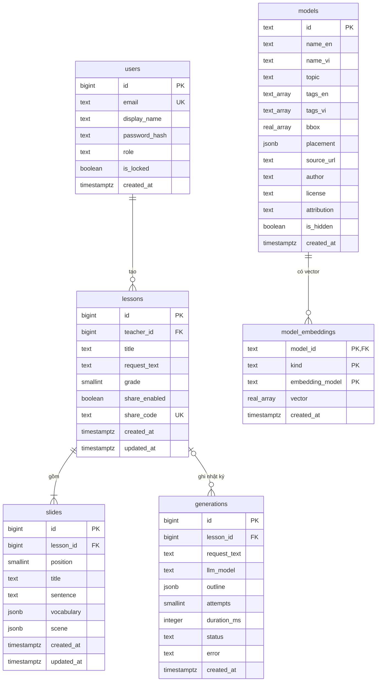

# Thiết kế cơ sở dữ liệu

Liên quan: CV2.3 (giai đoạn 2). Tệp tạo bảng: [`database/schema.sql`](../database/schema.sql); kiểm tra ràng buộc: [`database/check.sql`](../database/check.sql).

## 1. Sơ đồ quan hệ (ERD)

`slides.scene` chứa `modelId` trỏ tới `models.id` nhưng **không có khoá ngoại**, vì nằm trong `JSONB`. Do đó mô hình chỉ được **ẩn**, không được xoá (BR08).

## 2. Mô tả các bảng

| Bảng | Mục đích | Chức năng liên quan |
| --- | --- | --- |
| `users` | Tài khoản giáo viên và quản trị viên | F01–F03, F43 |
| `lessons` | Bài giảng của giáo viên | F10, F20, F31 |
| `slides` | Nội dung chữ và cảnh 3D của từng slide | F21–F25 |
| `generations` | Nhật ký mỗi lần sinh dàn ý | CV3.4, RQ3 |
| `models` | Thư viện mô hình 3D | F40–F42 |
| `model_embeddings` | Vector ngữ nghĩa của mô hình | CV4.2, RQ1 |

## 3. Ràng buộc và quy tắc nghiệp vụ

| Quy tắc | Cách thực hiện trong CSDL |
| --- | --- |
| Email không trùng, không phân biệt hoa thường | Chỉ mục duy nhất trên `lower(email)` |
| BR01: tối đa 10 slide | `slides.position` từ 1 đến 10, không trùng trong một bài giảng |
| BR01: tối đa 4 vật mỗi slide | Kiểm tra ở server bằng `scene.schema.json` (CSDL không kiểm tra bên trong `JSONB`) |
| BR03: thử tối đa 3 lần | `generations.attempts` từ 1 đến 3 |
| BR04: chỉ chủ bài giảng được sửa | Kiểm tra ở server qua `lessons.teacher_id` |
| BR05: chia sẻ bằng đường liên kết | Bật `share_enabled` thì bắt buộc có `share_code`; tắt chia sẻ thì xoá mã |
| BR06: mô hình có ít nhất 1 thẻ, có nguồn và giấy phép | `CHECK` trên `tags_en`; `source_url`, `author`, `license` bắt buộc |
| BR08: ẩn mô hình | Cột `is_hidden`; không xoá dòng |
| Đổi thứ tự slide (F25) | Ràng buộc không trùng thứ tự kiểu `DEFERRABLE`, kiểm tra lúc kết thúc giao dịch |
| Xoá giáo viên | Xoá theo bài giảng và slide; nhật ký sinh giữ lại, `lesson_id` thành rỗng |

## 4. Quyết định thiết kế

1. `models.id` là chuỗi trùng với `catalog.json`, tên tệp `.glb` và `modelId` trong cảnh 3D. Đường dẫn tệp và ảnh suy ra từ id nên không lưu.
2. Vector lưu kiểu `real[]` trong bảng riêng, không dùng pgvector. Thư viện khoảng 100 mô hình nên tính độ tương đồng trực tiếp trong Node.js. Mỗi mô hình có vector "tên đơn lẻ" (`name`) và "mô tả đầy đủ" (`full`) để so sánh ở RQ1.
3. Cảnh 3D lưu nguyên khối `JSONB` theo [`scene.schema.json`](../shared/schemas/scene.schema.json); server kiểm tra trước khi lưu.
4. `schema.sql` xoá và tạo lại toàn bộ bảng, chỉ dùng khi đang phát triển. Khi đã có dữ liệu thật, thay đổi cấu trúc phải viết thành tệp sửa đổi riêng.