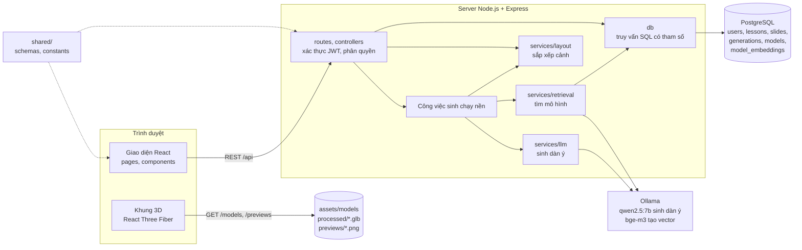
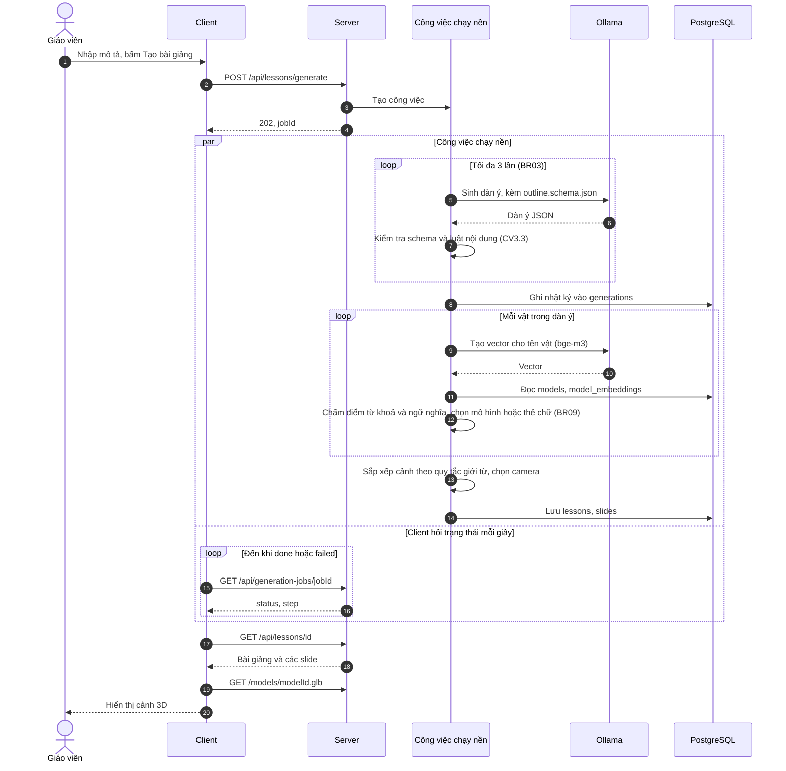
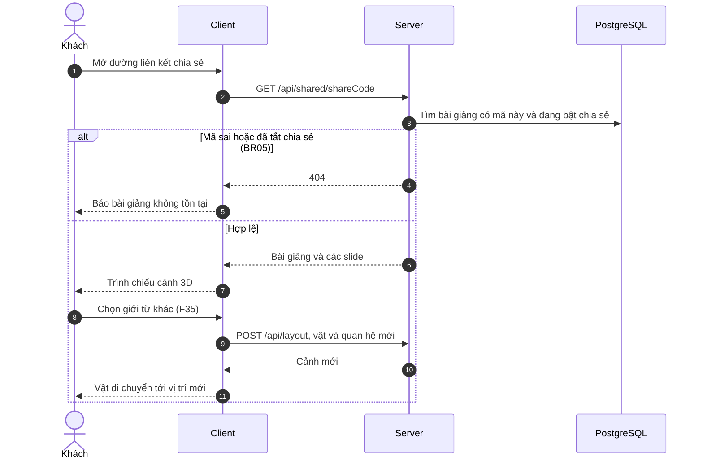

# Thiết kế kiến trúc

Liên quan: CV2.1 (giai đoạn 2). Tài liệu liên quan: [API](03-thiet-ke-api.md), [CSDL](02-thiet-ke-csdl.md), [cấu trúc JSON](04-thiet-ke-json.md), [quy ước thư mục](00-quy-uoc-du-an.md).

## 1. Sơ đồ thành phần

Toàn bộ hệ thống chạy trên **một máy cá nhân** (GPU 6 GB); cách đưa đường liên kết chia sẻ ra ngoài sẽ chốt ở CV2.7.

| Thành phần | Vị trí trong mã nguồn | Nhiệm vụ | Giai đoạn |
| --- | --- | --- | --- |
| Giao diện React | `client/src/pages`, `components` | Các màn hình soạn bài, trình chiếu, thư viện | 6 |
| Khung 3D | `client/src/scene` | Hiển thị cảnh theo `scene.schema.json`, xoay, bấm vật, đổi giới từ | 2 (khung), 6 |
| API | `server/src/routes`, `controllers`, `middlewares` | Nhận yêu cầu, kiểm tra dữ liệu và quyền ([docs/03](03-thiet-ke-api.md)) | 6 |
| Công việc sinh chạy nền | `server/src/services` | Điều phối 3 bước sinh, lưu trạng thái để client hỏi (F14) | 6 |
| Sinh dàn ý | `server/src/services/llm` | Gọi Ollama kèm `outline.schema.json`, kiểm tra, thử lại tối đa 3 lần | 3 |
| Tìm mô hình | `server/src/services/retrieval` | Kết hợp từ khoá và vector ngữ nghĩa, so với ngưỡng (BR09) | 4 |
| Sắp xếp cảnh | `server/src/services/layout` | Quy tắc cho 7 giới từ, chống chồng lấn, chọn camera | 5 |
| Truy cập CSDL | `server/src/db` | Mọi câu SQL có tham số (NFR03) | 2 (kết nối), 6 |
| Dùng chung | `shared/` | JSON Schema, danh sách giới từ và chủ đề | 2 |

## 2. Luồng sinh bài giảng

Sinh một bài giảng mất 20–60 giây, nên chạy nền; client hỏi trạng thái mỗi giây ([docs/03](03-thiet-ke-api.md), mục 2.2).

Dữ liệu biến đổi qua từng bước:

| Bước | Đầu vào | Đầu ra | Định dạng |
| --- | --- | --- | --- |
| Sinh dàn ý | Mô tả của giáo viên | Dàn ý: chữ và quan hệ, không có toạ độ | `outline.schema.json` |
| Ghép nghĩa tiếng Việt (CV3.2a) | Dàn ý, `models.name_vi` | Từ vựng kèm nghĩa | `slides.vocabulary` |
| Tìm mô hình | Tên vật trong dàn ý | `modelId` của từng vật, hoặc `null` | |
| Sắp xếp cảnh | Vật, `modelId`, quan hệ, kích thước trong `models` | Cảnh có toạ độ và camera | `scene.schema.json` |

## 3. Luồng xem bài giảng được chia sẻ và đổi giới từ

Khách không cần đăng nhập. Khi đổi giới từ (F35), client gửi lại vật và quan hệ mới; server chỉ tính lại cảnh, **không lưu** vào bài giảng.

## 4. Nguyên tắc thiết kế

1. **LLM chỉ sinh quan hệ, không sinh toạ độ**; vị trí do bộ sắp xếp cảnh tính ([docs/06](06-khao-sat-nghien-cuu-lien-quan.md), mục 4.3).
2. **Ba bộ phận nghiên cứu tách riêng** (`llm`, `retrieval`, `layout`), mỗi bộ phận chạy được bằng dòng lệnh để làm thực nghiệm RQ1–RQ3 mà không cần giao diện.
3. **Phần gọi LLM tách thành lớp riêng** để đổi mô hình mà không sửa phần khác (NFR06, so sánh mô hình ở RQ3).
4. **Cấu trúc dữ liệu định nghĩa một lần** trong `shared/`; client, server và kiểm thử cùng dùng.
5. **Kiểm tra quyền ở server** cho mọi API (NFR03); client chỉ ẩn nút, không phải lớp bảo vệ.